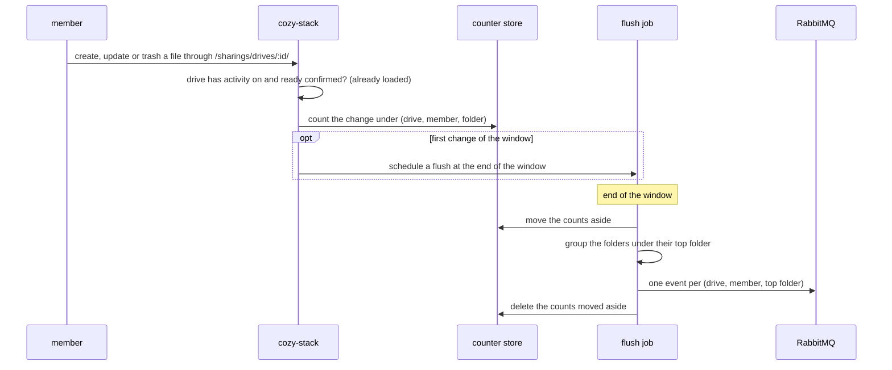

# ADR: Drive activity digest

## Status

Proposed

## Date

2026-10-12

## Context

We want apps that provision organization drives ([ADR 009](009-adr-org-drive-provisioning.md)) to know when members add, change or delete files in them, so TwakeSpace can show it in the space's activity feed.

Dropping or selecting many files can add thousands of them at once, across many organizations, so the stack reports files in batches instead of one by one.

Detecting a batch upload does not work in general: the Drive web app uploads a drop or a "select all" as separate files, and the desktop client, WebDAV and the API send files one at a time too.

## Decision

- The stack counts the files created, updated and deleted in a drive per member, and publishes one event per drive, member and top folder at the end of a time window.
- The window is configurable per context, and defaults to 30 seconds.
- Only drives with `activity: true` in their [ADR 009](009-adr-org-drive-provisioning.md) command are counted, once their `ready` reply is confirmed. Other drives pay nothing.
- Only changes made through the shared drive routes are counted in this version.
- For Drive, this replaces the one event per action of [ADR 006](https://github.com/linagora/twake-space-architecture/blob/d8b85ecbe0cfffba446a410ab999e49ba949d621/ADR006.md) (`file.created`, `file.updated`, `file.deleted`). The rest of ADR 006 holds: a CloudEvent on the `activity` exchange, `data.object` with the drive as `container`, and the actor's email in `twakeactor`.

### Flow



- Per change, the cost is one write to the counter store. There is no CouchDB write, no job and no message.
- The counter store is Redis when the stack has one, as for rate limits, and memory otherwise.
- The flush is an `@in` trigger with the window as its duration, created by the first change of a window.
- The counter keeps, per folder, the number of files created, updated and deleted, and the first five names. Folders are grouped under their top folder (the folder directly under the drive root) at flush time, once per folder, not once per file. A file at the root of the drive counts under the drive's root folder.
- A deleted file is one sent to the trash. It counts under the folder it was in.

### The event

Routing key `com.twake.drive.folder.changed.v1` on the `activity` exchange:

```json
{
  "specversion": "1.0",
  "id": "5c0e9f3a-2b71-5d4e-8a96-7f1c3d2e4b50",
  "source": "twake://drive",
  "type": "com.twake.drive.folder.changed.v1",
  "time": "2026-10-12T09:15:30Z",
  "twakeorg": "org123",
  "twakeactor": "alice@example.com",
  "data": {
    "object": {
      "type": "folder",
      "id": "8ff66e0ee58e",
      "title": "Q4 assets",
      "container": { "kind": "drive", "id": "a1f0c3e2d4b5" }
    },
    "files": { "created": 1200, "updated": 3, "deleted": 0 },
    "samples": ["logo.svg", "banner.png", "brief.pdf", "budget.xlsx", "notes.md"]
  }
}
```

- `id` is a UUIDv5 of the drive, the member, the top folder and the window start. A flush job that runs twice publishes the same id, and TwakeSpace already drops events it has seen.
- `object` is the top folder, so TwakeSpace's feed card for that folder updates with each window instead of adding a new card. A long upload that spans many windows stays one card.
- `twakeactor` is the member's email. The stack does not know the member's `entryUUID`, so `twakeactorid` is left out, as ADR 006 allows.

### Volume

- A drop of 5,000 files over 2 minutes, with a 30 second window: about 4 messages instead of 5,000.
- Many organizations at once: the number of messages depends on how many drives and members are active in a window, not on how many files they send.

### Configuration

```yaml
contexts:
  default:
    drive_activity:
      window: 30s
```

### Failures

- Counter store unavailable: the change succeeds and is not counted. The digest is best effort and never fails a request.
- RabbitMQ unavailable at flush time: the job is retried by the job system. The counts it moved aside are only deleted after publishing, so the retry publishes the same events with the same ids. Changes made meanwhile go to the next window.
- A crash of the stack between two windows can lose the counts held in memory when there is no Redis.

## Consequences

- One message per window, member and top folder, whatever the number of files.
- The feed is up to one window late.
- The app learns how many files changed, and five names, not the full list. An app that needs every file reads the drive's changes feed (`GET /sharings/drives/:id/_changes`).
- TwakeSpace shows a folder card with counts instead of one card per file.

## Open questions

- Should changes made directly on the organization instance (by an admin, not through the drive routes) be counted?
- A file at the root of the drive is shown under the drive's root folder, so all root changes share one card. Is that what TwakeSpace wants?
- Do moves into or out of the drive count as created and deleted?
