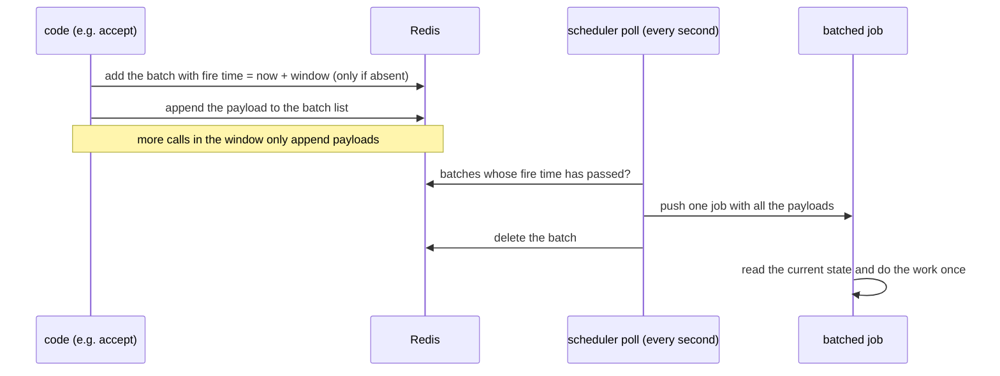

# ADR 011: Batched background updates

## Status

Proposed

## Date

2026-11-02

## Context

Some changes start background work that sends the latest state somewhere. When many changes arrive together, the stack does that work once per change, even though only the last run matters.

The sharing member list is the main example today:

- After a change to the members of a sharing (accept, add, revoke, read-only, group change), the owner sends the full member list to every recipient with `NotifyRecipients`. 13 places in the code call it.
- When a group of N members auto-accepts, each accept sends the list to every recipient: up to N × N requests, each one carrying all N members.
- Each run waits 3 seconds, takes the sharing lock, then sends one request per recipient, one after the other. A run that waits more than 20 seconds for the lock gives up without an error. So recipients often keep an outdated member list. The org drive fanout load test sees it: recipient member lists can stay unresolved.

Other features have the same shape. [ADR 010](010-adr-drive-activity-digest.md) counts drive activity and sends it at the end of a time window, with its own Redis keys and an `@in` trigger.

The job system can already batch, but only for triggers stored in CouchDB. A debounced `@event` or webhook trigger sets a fire time on its first event, collects the payloads of the next events, and then runs one job with all of them (`model/job/redis_scheduler.go`). Code that has no trigger document cannot use it.

## Decision

- Add a way to push a batched job from code, without a trigger document: `job.PushBatched(inst, request, key, window)`.
- A batch is identified by the instance, the worker type and a key chosen by the caller, for example the sharing ID.
- The first call for a batch starts its window. Calls during the window only add their payload, if they have one. At the end of the window, one job runs with all the payloads.
- The window starts at the first call, not the last one. Work is late by at most one window, even when changes never stop.
- The job reads the current state when it runs. Payloads are hints, such as which members changed, never the data to send. Running the same batch twice must be safe.
- First user: the sharing member list. The 13 call sites push a batched `share-members` job with the sharing ID as the key. The job loads the sharing and sends the list once to each recipient, a few requests at a time. The 3 second wait becomes the batch window, and the lock around the sending goes away.
- Second user: realtime events for sharings, once [ADR 012](012-adr-sharing-members-storage.md) moves members out of the sharing document.
- Other features use it when they have the same shape: many changes, and one result that only depends on the latest state.

### Flow



- Redis holds a sorted set of batches scored by fire time, and one list of payloads per batch. These are the same commands that debounced triggers use.
- The existing scheduler poll loop picks up the batches that are due.
- The job is pushed before the batch is deleted. If pushing fails, the batch stays and the next poll tries again.
- A call that arrives after the batch is picked up starts a new window. A change is never lost: either the running job reads it, or it runs in the next batch.
- Without Redis (a single stack, dev, tests), the in-memory scheduler does the same with a timer.
- If Redis fails when adding to a batch, the code pushes a normal job right away. It is slower, but nothing is lost.

### Configuration

```yaml
jobs:
  workers:
    share-members:
      batch_window: 3s
```

Each batched worker has a default window. `batch_window` sits next to the existing worker settings (`concurrency`, `max_exec_count`, `timeout`) and can change it.

### Volume

- A group of 100 members whose answers arrive over 30 seconds, with a 3 second window: about 10 rounds of 100 requests, instead of up to 10,000.
- A single change: one round, up to 3 seconds later, as today.

## Consequences

- Recipients see member list changes up to 3 seconds late, as today: each run already waits 3 seconds. The difference is that the change now always arrives.
- A revoked member is told by the revocation, not by the member list, so this does not delay it. Only the member list sent to the other recipients waits for the window.
- The time spent on member lists grows with the number of members, not with members × changes.
- Redis holds one more sorted set, and one small list per open batch.
- Tests that expect the member list to be sent right away must run the batch, or use a zero window.

## Open questions

- Should ADR 010's activity digest move to this mechanism?
- Which other features should use it?
- Should the first change of a window be sent right away, and only the next ones batched? It would remove the delay for single changes. It can be added later without changing the callers.
