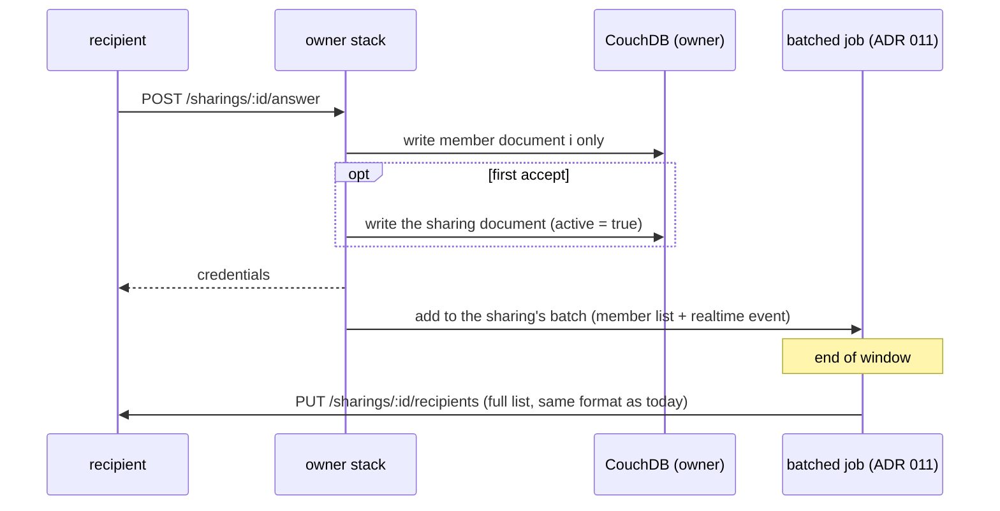

# ADR 012: Sharing members in their own documents

## Status

Proposed

Implementation details: [Sharing members storage: implementation notes](012-sharing-members-storage-implementation.md).

Uses [ADR 011](011-adr-batched-background-updates.md) for member lists and realtime events.

## Date

2026-11-02

## Context

A sharing is one CouchDB document in `io.cozy.sharings`. It holds everything: rules, flags, groups, all the members, and the credentials used to talk to each member.

Every change rewrites the whole document:

- The document grows with each member, and so does the cost of every write. `couchdb.UpdateDoc` also reads the old version before writing, so each change moves the document twice.
- Changes to different members collide, because they all write the same document.

The org drive fanout load test shows the limit. At about 100 members, auto-accept fails:

- Each accept sends an answer to the owner. `ProcessAnswer` rewrites the whole sharing and retries only once on a conflict.
- The recipient's `share-autoaccept` job tries 4 times. When many answers arrive together, the late ones lose every time, get a 409 on every try, and stay pending.

The same collisions cause quieter bugs:

- A refreshed token is not saved when another change was written at the same time (`Credentials.Refresh` ignores conflicts).
- The invitation status save races with the answers.

A lock does not fix this. CouchDB already lets one write through at a time; a lock only makes the others wait. The wait grows with the size of the document and the number of answers in flight, and the lock gives up after 20 seconds.

The member limit is 90 by default (`max_members_per_sharing`, per context). Org drives need more.

## Decision

### Keep the API as it is

Nothing changes for clients or other stacks:

- the `/sharings` routes and their JSON:API responses;
- the calls between stacks: invitation, answer, and `PUT /sharings/:id/recipients` with the full member list;
- the realtime events on `io.cozy.sharings`.

Only the way the stack stores a sharing changes.

### Store each member in its own document

- **Sharing document**, in `io.cozy.sharings`, same ID as today: everything except members and credentials (rules, flags, groups, triggers, and so on). Every existing query and index uses only these fields, so they keep working.
- **One document per member**, in a new doctype `io.cozy.sharings.recipients`. It holds the member and the credentials used to talk to that member. Its ID is `<sharing id>/<member index>`.
  - The member index is the member's position, and it never changes: members are never removed from a sharing; revoked members stay.
  - `io.cozy.sharings.recipients` is already the JSON:API type of `GET /sharings/recipients/:file-id` (effective recipients), and cozy-client uses it for those responses. They never meet these documents: effective recipients are computed and never stored, and these documents never leave the stack (see below).
- The same storage is used on the owner and on recipients.

### The Go code keeps its shape

- `Sharing` keeps its `Members` and `Credentials` fields.
- Loading a sharing reads the sharing document, then all its member documents in one request.
- Saving writes only what changed: the sharing document if one of its fields changed, and the changed member documents in one request. This replaces the direct `couchdb.UpdateDoc` calls on sharings.
- Changes to different members never collide anymore. Changes to the same member, or to the sharing document, still can, and keep today's conflict handling.

### Realtime and access

- The member doctype is blocked in the data API, like `io.cozy.sharings`, and the stack never publishes realtime events for it.
- The stack publishes the realtime event on `io.cozy.sharings` itself, with the whole sharing and no credentials. It sends one event per batch ([ADR 011](011-adr-batched-background-updates.md)), not one per member write.

### Roll out in three releases

Stacks of different versions run side by side during a deploy, and an old stack would see a sharing with no members.

1. The stack reads both formats and still writes the old one.
2. A config flag makes the stack write the new format. A sharing moves to the new format the first time it is saved. The flag is turned on only once every stack runs this release.
3. A migration moves the remaining sharings, and reading the old format is removed.

The calls between stacks do not change, so owners and recipients on different versions work together at every step.

### Member limit

The default limit stays at 90 until load tests on the new storage give the new numbers.

### Flow: one accept, after the change

## Consequences

- Answers, token refreshes and status changes for different members no longer collide. Accepts stop failing with 409.
- The cost of a change no longer depends on the number of members.
- Loading a sharing takes 2 reads instead of 1. Loading many sharings uses one query for all their members.
- CouchDB has no transaction across documents. Operations that change many members and the sharing document (revoke, add or remove a group) write the member documents first and the sharing document last, so a failed run can be retried. A member and its credentials are in the same document, so they always change together.
- Each instance that uses sharing gets one more CouchDB database.
- Each member can have its own state. For example, the revocation job could mark members as "revoking" and carry only the sharing ID, with no credentials in the job. That is not decided here.
- The owner still sends the member list to every recipient after a change. [ADR 011](011-adr-batched-background-updates.md) makes that once per batch instead of once per change.

## Open questions

- Should Drive recipients read the member list from the owner instead of storing it? That would remove the member list push for drives. It changes the protocol, so it needs its own ADR.
- What new default member limit do the load tests support?
- When can reading the old format be removed?
