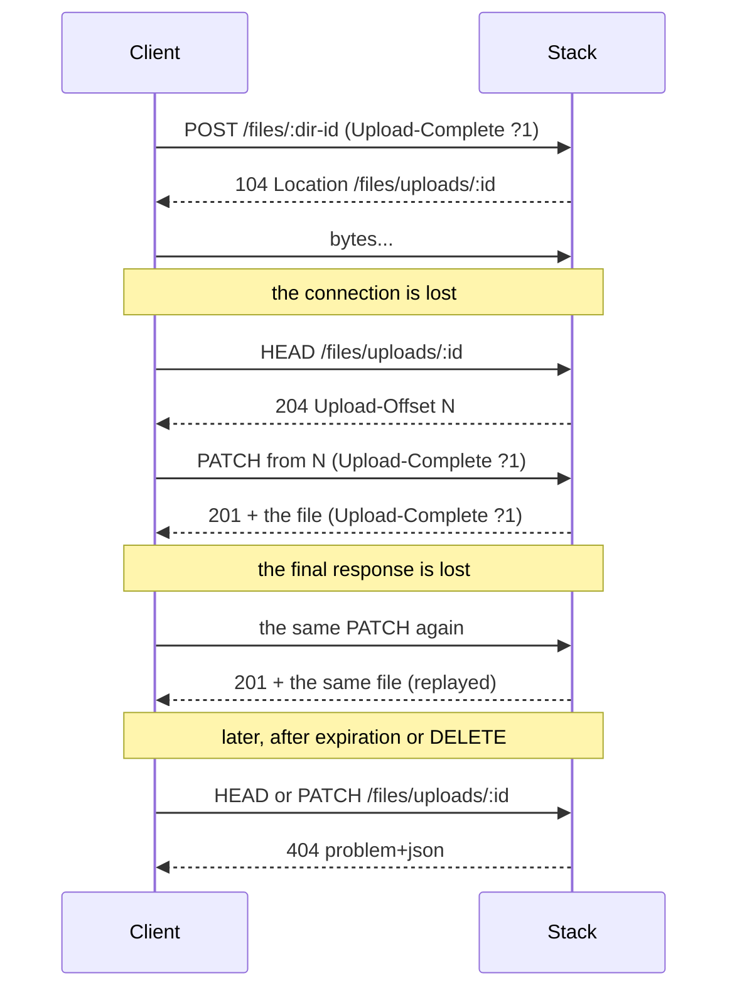
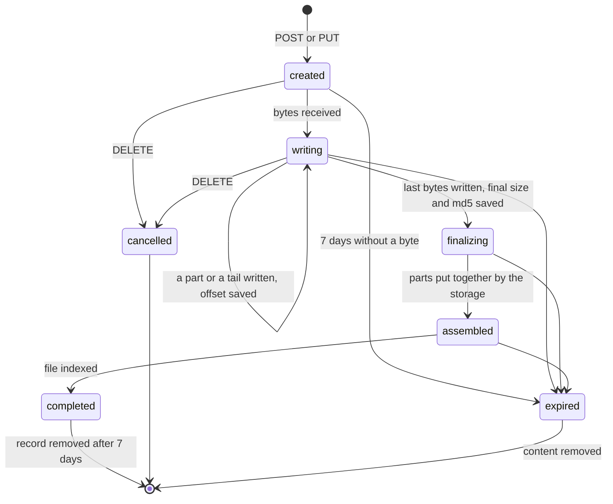
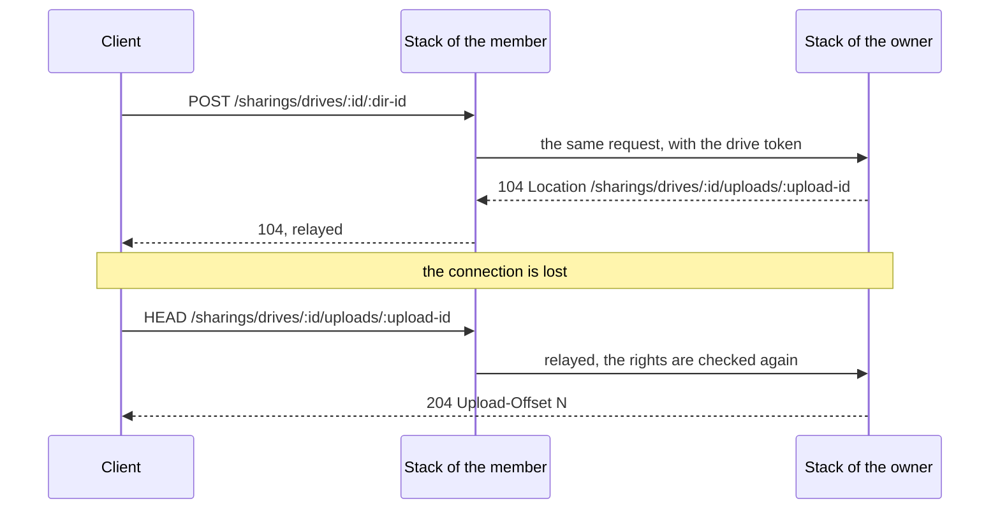
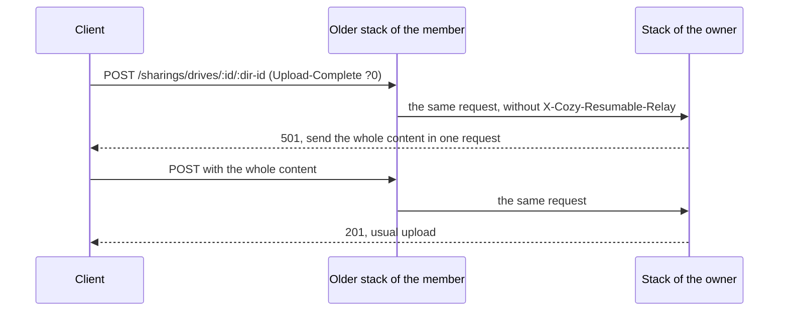
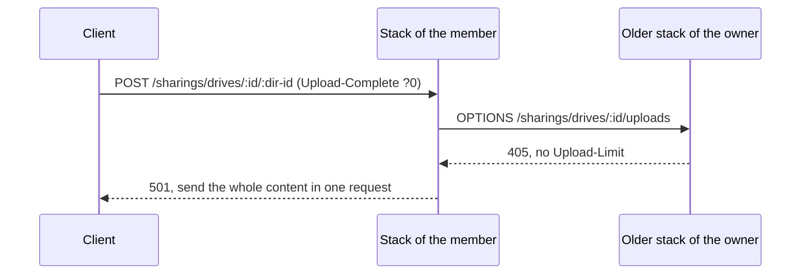
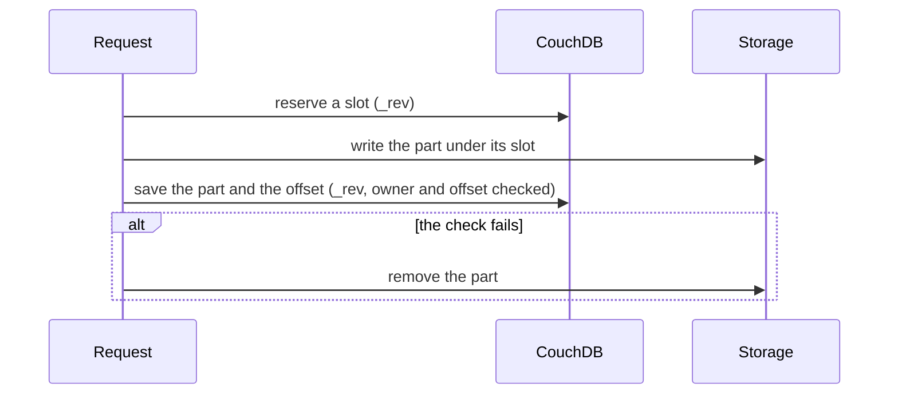

[Table of contents](README.md#table-of-contents)

# Resumable uploads

## Why

A file is uploaded in one request. When this request is cut (the app is
suspended, the network is lost, a proxy closes an idle connection after 50
seconds), the upload starts again from the first byte. With resumable
uploads, the client goes on from the last byte kept by the stack, on the web
and on mobile, and it can also pause an upload and resume it later.

The HTTP API is described in [files.md](files.md#resumable-uploads). This
document explains how the stack implements it.

## Protocol

The stack follows the IETF draft [Resumable Uploads for
HTTP](https://www.ietf.org/archive/id/draft-ietf-httpbis-resumable-upload-15.html),
version -15. It accepts the interop versions 6 (draft -05, spoken by
URLSession on iOS 18.1+ and macOS, and by tus-js-client) and 10 (draft -15),
given in the `Upload-Draft-Interop-Version` header.

An **upload** is the resource that keeps the state of a file being sent,
at `/files/uploads/:upload-id`. Four requests act on it:

- `POST /files/:dir-id` or `PUT /files/:file-id` with `Upload-Complete`
  creates the upload. The stack announces it with a `104` interim response
  and a `Location` header, then reads the content
  ([§6](https://www.ietf.org/archive/id/draft-ietf-httpbis-resumable-upload-15.html#section-6),
  [§12](https://www.ietf.org/archive/id/draft-ietf-httpbis-resumable-upload-15.html#section-12)).
- `HEAD` returns the **offset**: the number of bytes kept by the stack
  ([§7](https://www.ietf.org/archive/id/draft-ietf-httpbis-resumable-upload-15.html#section-7)).
- `PATCH` appends bytes at the offset. `Upload-Complete: ?1` marks the last
  ones
  ([§8](https://www.ietf.org/archive/id/draft-ietf-httpbis-resumable-upload-15.html#section-8)).
- `DELETE` cancels the upload and frees the storage
  ([§9](https://www.ietf.org/archive/id/draft-ietf-httpbis-resumable-upload-15.html#section-9)).

A browser does not see the `104`: a web client creates the upload with an
empty `POST` and `Upload-Complete: ?0`, then sends the content with `PATCH`.

- A response with `Upload-Complete: ?1` is the final answer: the file, or the
  reason why it cannot be created (md5, length, quota, name taken). After any
  other error, the client resumes
  ([§4.2.1](https://www.ietf.org/archive/id/draft-ietf-httpbis-resumable-upload-15.html#section-4.2.1),
  [§11](https://www.ietf.org/archive/id/draft-ietf-httpbis-resumable-upload-15.html#section-11)).
- When the final response is lost, the request that has completed the upload
  gets the same response again, so the file is not created twice
  ([§8.2](https://www.ietf.org/archive/id/draft-ietf-httpbis-resumable-upload-15.html#section-8.2)).
- An upload that has expired, has been cancelled, or has never existed
  answers `404` with an `application/problem+json` body. The draft asks to
  reject any further request
  ([§4.1](https://www.ietf.org/archive/id/draft-ietf-httpbis-resumable-upload-15.html#section-4.1))
  without naming a status code.
- A new request on an upload (`HEAD` or `PATCH`) makes it the only writer.
  When an older request is still running, the new one waits for it to save
  the bytes it has received, at most 5 seconds, then the older one cannot
  write anymore. The offset answered is never outdated
  ([§10](https://www.ietf.org/archive/id/draft-ietf-httpbis-resumable-upload-15.html#section-10)),
  and the bytes of a request cut by a pause or a lost connection are kept
  even if the client resumes at once.

## Compatibility

- `POST /files/:dir-id` and `PUT /files/:file-id` do not change, and have no
  new parameter.
- A request uses the resumable upload only when it has
  `Upload-Draft-Interop-Version` set to `6` or `10` and a valid
  `Upload-Complete` header. The current clients, and the other interop
  versions, get the **usual upload**: one request, one object, without parts.
- The stack also falls back to the usual upload for a content that fits in
  one part, at the limit of uploads in progress (for a request with the whole
  content), and on a storage without resumable uploads.
- A request with `Upload-Complete: ?0` has no content, so it never falls back
  to the usual upload, which would create an empty file. At the limit of
  uploads in progress it gets `429`; with another interop version, on a
  storage without resumable uploads, for a note (`.cozy-note`, imported in one
  request), or with `SourceURL`, it gets `501` with an
  `application/problem+json` body, and nothing is created or imported. The
  client then sends the whole content in one request.
- The new routes are `HEAD`, `PATCH` and `DELETE` on
  `/files/uploads/:upload-id`, and on
  `/sharings/drives/:id/uploads/:upload-id` for the
  [shared drives](#shared-drives).
- The `resumable_uploads` capability of
  [`GET /settings/capabilities`](settings.md#get-settingscapabilities) is true
  when the VFS of the instance accepts the resumable uploads. A client checks
  it before sending `Upload-Complete: ?0`: an older stack, without resumable
  uploads, creates an empty file for such a request.
- A name already taken is refused with `409` when the upload is created, like
  the usual upload, and checked again at the end.
- A drive member whose stack does not relay `X-Cozy-Resumable-Relay` is
  answered as on a storage without resumable uploads (see [A member on an
  older stack](#a-member-on-an-older-stack)).
- In a shared drive, the stack of the member checks that the stack of the
  owner can resume before it relays a request with `Upload-Complete: ?0`, and
  answers `501` otherwise (see [An owner on an older
  stack](#an-owner-on-an-older-stack)). `OPTIONS
  /sharings/drives/:id/uploads` is new.

## The io.cozy.files.uploads document

Each upload is a document of the `io.cozy.files.uploads` doctype, in the
database of the instance. Apps cannot read it, and it is not exported. Its
fields:

- `file`: the document of the file to create, with its final `_id` and
  `internal_vfs_id`. It is indexed in `io.cozy.files` only at the end.
- `old_file_id`, `old_rev`: the file whose content is replaced (`PUT`), and
  the revision expected by the client in `If-Match`.
- `drive_id`, `drive_member`: the shared drive and its member (email, or
  instance) who have created the upload, for an upload by a member (see
  [Shared drives](#shared-drives)).
- `length`: the size announced by the client, or -1 while unknown.
- `offset`: the bytes written to the storage. It is saved only after the
  bytes are written, so it never goes backward.
- `md5_state`: the state of the md5 of the bytes up to the offset, to check
  `Content-MD5` on the whole file without reading it again.
- `owner`: a token of the request that may write. A new request takes it,
  and the writes of the older one do not count.
- `running`: the request of the owner is appending.
- `previous_owner`: the token of an older request still running, that may
  save the bytes it has received while the new one waits for it.
- `by_link`: the upload is made through a sharing by link.
- `parts`: the parts written to the storage (slot, name, ETag, size).
- `tail`: the bytes after the last part, kept in a temporary object until the
  next part.
- `next_part`, `next_tail`: the last slots given to a part and to a tail.
  Each write has its own slot, and so its own object. The tails have their
  own slots, so the number of a part stays under the 10,000 parts of S3,
  whatever the size of the requests.
- `writing`: the size of the write in progress, counted in the quota by the
  other uploads.
- `storage_id`: the ID of the S3 multipart upload.
- `finalizing`: all the bytes are written; the offset is the final size.
- `assembled`: the storage has put the parts together.
- `completed`: the file is indexed. The record stays to replay the final
  response.
- `removed`: the upload is being removed. It is not found anymore, and the
  cleaning finishes a removal that has failed.
- `created_at`, `expires_at`: the creation date, and the date after which the
  upload is removed (7 days after the last byte).

Why CouchDB:

- Several stacks run behind a load balancer: the `PATCH` that resumes an
  upload can reach another stack than the `POST` that created it.
- The state survives a restart or a deployment of the stacks.
- The document is deleted with the instance.
- The `_rev` of the document guards the state of the upload, without lock
  (see [Concurrency and locks](#concurrency-and-locks)).
- The database and its index on `completed` are created with the first
  resumable upload of the instance: an instance without resumable uploads has
  no such database, and the other requests consider a missing database as
  having no upload.

Redis is optional in cozy-stack (a single stack runs without it), and its
data can be lost on a restart or evicted, while an upload can last days.

## Life of an upload

What happens after a stop of the stack:

- `writing`: the bytes received after the last saved offset are lost. `HEAD`
  returns the saved offset, and the client sends them again.
- `finalizing`, `assembled`: `HEAD` returns the final size with
  `Upload-Complete: ?0`. The client sends an empty `PATCH` with
  `Upload-Complete: ?1`, and the stack runs the remaining steps again: S3
  checks the object when the multipart upload is already completed, Swift
  writes the same manifest, and a file already indexed is recognized.
- An error that tells that the file cannot be created (name taken, quota,
  wrong md5 or size, revision changed) removes the upload. Any other error
  keeps it resumable.

A content that fits in one part is created as a usual upload.

## Storage

The bytes after the last part are kept in a temporary object (the tail) until
the next part: S3 refuses parts under 5 MiB, and a Swift manifest accepts at
most 1000 segments. A request smaller than a part rewrites the tail with its
bytes: requests of at least a part (16 MiB by default) avoid these copies.

- Local file system (afero): each part and each tail is a file in
  `/.cozy_uploads/:upload-id/`. At the end, the parts are concatenated in a
  new file, which is moved at its place: this costs a local copy of the file.
  fsck skips this directory.
- S3: the parts are the parts of a multipart upload on the key of the file,
  started with the upload; the number of a part is its slot. The tails are
  objects under `uploads/:upload-id/`. The file is a plain object once the
  multipart upload is completed.
- Swift: the parts are segments under `uploads/:upload-id/`, named after their
  slot, and the file is a Static Large Object (SLO) manifest that points to
  them.

What the Swift manifests change:

- Deletion (trash, purge, old versions, erasure of an instance): the internal
  ID of these files starts with `slo-`, and they are deleted with
  `multipart-manifest=delete`, which removes the segments too.
- Copy and dissociation of a shared file: Swift copies the content of the
  manifest, and the copy is a plain object. A storage migration reads the
  content and writes it to the target as a plain object.
- Versions: the old version keeps its manifest and segments until it is
  cleaned.
- fsck: it skips `uploads/` and compares only the size of the `slo-` files,
  as the hash of a manifest is not the md5 of the content.

On all the storages, a storage migration removes the uploads in progress,
with their content, before the switch, as their parts are on the source.

## Shared drives

A member of a shared drive sends a file with the drive routes of their own
stack. The upload lives on the instance of the owner, like the file it
creates.

- The `io.cozy.files.uploads` document and the parts are on the instance and
  the storage of the owner. The quota and the expiration are those of the
  owner. The `max-size` of `Upload-Limit` tells a member the free space of the
  owner.
- Each member is an account for the limits, whatever the drive: 20 uploads
  in progress by default, apart from the 20 of the owner. A member at their
  limit stops neither the other members nor the owner. The 200 uploads of the
  instance count them all.
- The routes are `HEAD`, `PATCH` and `DELETE` on
  `/sharings/drives/:id/uploads/:upload-id`. Like the other drive routes, the
  stack of the member serves them directly when the owner is on the same
  stack, and relays them over HTTP with the drive token otherwise.
- `Location` is a relative URL with this path. The sharing has the same ID on
  both instances, so the client resolves it against the stack of the member,
  which relays it. Nothing is rewritten.
- Each request checks the rights again, on the instance of the owner: the
  member behind the drive token, then their effective write access on the
  folder of the upload, or on the file whose content it replaces. A member
  removed from the drive or made read-only gets `403` on the next request,
  `HEAD` included, as it takes the upload over. The parts already written stay
  until the upload expires.
- The upload keeps the drive and the member who have created it
  (`drive_id`, `drive_member`). An upload of another member, of another
  drive, or outside the drive answers `404`, like a missing one.
- The relay forwards the `104` interim response: Go's `httputil.ReverseProxy`
  relays the 1xx responses, and the stack writes them on the connection
  directly, so that echo keeps the final status.

### A member on an older stack

The stack of a member and the stack of the owner can run two versions of
cozy-stack:

- during a deployment;
- for a long time when they are on two platforms, for example SaaS and an
  on-premise platform: a shared drive can join instances of different
  domains.

An older stack relays the request as it is, and the owner would start a
resumable upload. A client that does not see the `104`, like a browser,
creates an empty upload first (`Upload-Complete: ?0`), then:

- it gets `200` instead of `201`, as the older relay takes the `104` for the
  final status;
- it cannot continue: the older stack has no route for `HEAD` and `PATCH` on
  `/sharings/drives/:id/uploads/:upload-id`;
- the upload stays open on the owner's instance for 7 days, and takes one of
  the places of the member.

So the relay announces that it knows the resumable uploads:

- the stack of the member sets `X-Cozy-Resumable-Relay: 1` on each request
  it relays to the owner, and on the requests it serves directly when the
  owner is on the same stack;
- the owner starts a resumable upload for a drive token only with this
  header;
- without it, the member is answered as on a storage without resumable
  uploads: the usual upload for a request with the whole content, and `501`
  for `Upload-Complete: ?0`.

No web client speaks the protocol yet: this case becomes real when Drive
web adopts it.

### An owner on an older stack

The `resumable_uploads` capability describes the stack of the member, not the
stack of the owner. A stack of the owner older than the resumable uploads
would make an empty file of a request with `Upload-Complete: ?0`. So the
stack of the member asks the owner first:

- `OPTIONS /sharings/drives/:id/uploads` answers with `Upload-Limit:
  min-size=0` when the uploads to the drive can be resumable
  ([§5.2](https://www.ietf.org/archive/id/draft-ietf-httpbis-resumable-upload-15.html#section-5.2)),
  and without this header otherwise. An older stack has no such route.
- Before it relays a `POST` or a `PUT` with `Upload-Complete: ?0`, the stack
  of the member sends this request to the stack of the owner, with the drive
  token. When the owner is on the same stack, it looks at the storage of the
  owner instead.
- The answer is kept 3 hours, by drive and address of the owner, in the
  memory of the stack; each new answer removes the expired ones. A failure to
  reach the owner is not kept, and the request gets `502`.
- A redirection is not followed, as it would send the drive token to another
  address: it counts as an owner that cannot resume, and is not kept.
- When the owner cannot resume, the request gets `501`, as on a storage
  without resumable uploads: nothing is relayed, and the client sends the
  whole content in one request.
- A request with the whole content is relayed as it is: an older owner makes a
  usual upload of it.

A client asks the stack of the member the same way, with `OPTIONS` on this
route, to know if the uploads to a drive can be resumable. Its token needs
the same right as for the other drive routes, on `io.cozy.files`, checked
before the owner is asked. A browser cannot:
the stack answers the `OPTIONS` requests with an `Origin` as CORS preflights.

## Settings and limits

In the `fs.resumable_uploads` section of the configuration:

- `part_size`: 16 MiB by default, 5 MiB at least. Each request buffers one
  part in the temporary directory of the stack.
- `max_age`: 7 days without a new byte before an upload is removed.
- `max_per_account`: 20 uploads in progress for one account, by default.
- `max_per_instance`: 200 uploads in progress for the instance, all accounts
  together, by default.

The owner of the instance is one account. At either limit, a request with
`Upload-Complete: ?0` gets `429`, and a request with the whole content is a
usual upload. The limits count the uploads in progress, read with the index
on `completed`.

The usual upload is also used for the requests without the protocol headers,
`SourceURL`, and notes. A `SourceURL` is downloaded by the stack itself, so
there is no client to resume it. The uploads in progress count in the quota,
checked before each part: an upload that goes over it gets `413` and is
removed. A length announced on creation or on an append must fit in the space
left. The other uploads count with their announced length, except the ones of
a sharing by link, which count only with their written bytes: a visitor
cannot take the space of the uploads of the owner. The `max-size` of
`Upload-Limit` is the space left on the
instance, and is not announced to the visitors of a sharing by link. A daily
`clean-uploads` job per instance removes the expired uploads with their
content.

## Concurrency and locks

No ADR describes the lock of the VFS yet.

The lock of the VFS:

- Each storage takes it in one place for the uploads: `commitFile`, which
  adds a file to the index and puts its content at its place. It is the same
  critical section as the usual upload (the `Close` of a file created with
  `CreateFile`).
- It protects the checks made just before indexing: no other file with the
  same name in the directory, the parent not in the trash, the versions of
  the file.
- The storage migration holds it in write mode for the whole copy.

The state of an upload:

- No lock: each change reads a fresh copy of the document, checks that it
  still applies (the request is the owner, the offset has not moved), and
  saves it with its `_rev`. On a conflict, the change is evaluated again on
  the new state.
- A cut request often learns about the cut after the client has resumed: the
  `HEAD` of the client arrives before the stack has saved the bytes received.
  A request marks the upload as `running` while it appends. A new request
  takes the upload, keeps the token of the running one in `previous_owner`,
  and waits, at most 5 seconds, until this field is empty:
  - the older request can still save the bytes it has received, at the
    current offset, and empties the field in the same `_rev` update, then
    stops;
  - after the wait, the new request empties the field itself: the older
    request, stuck or on a stopped stack, cannot write anymore, and its write
    in progress is removed.

  The new request then answers an offset that no older request can move: the
  draft forbids outdated offsets, and recommends to stop the older request
  ([§10](https://www.ietf.org/archive/id/draft-ietf-httpbis-resumable-upload-15.html#section-10)).
  The state lives in CouchDB, so this works across stacks. The requests of a
  stack that wait for the same upload share one wait, which reads the
  document more and more rarely (from 50 ms to 500 ms).
- Out of any lock: the writes of the parts and tails to the storage, the
  assembling, and the extraction of the metadata. Each write has its own slot
  and object, so the uploads of an instance, and two requests on one upload,
  never write the same object.
- The creation of an upload counts the uploads in progress and saves the new
  one under a short lock of the instance, held only for these CouchDB reads
  and this write: uploads created at the same time cannot all pass the
  limits.
- A removal (`DELETE`, expiration, migration) first marks the document, then
  removes the content, then the document. Before removing the content, it
  looks for the file in the index, which takes the lock of the VFS in read
  mode: a removal that arrives while the file is indexed waits for the end of
  `commitFile`, finds the file, and keeps its content.

Orphan parts:

- A write that does not count (another request has resumed the upload, or it
  has been removed) is removed by the request that has written it.
- A write left by a stop of the stack is removed with the other objects of
  the upload: at the end of the upload (S3 and Swift remove the objects that
  are not in the file, afero removes the directory), or when it is removed.

The storage migration:

- It takes the lock of the VFS, then removes the uploads. This removal goes
  through the VFS of the source, which has its own lock, so it does not wait
  for the uploads.
- An upload that finishes during the migration waits for the lock of the VFS
  in `commitFile`. Once it holds it, it checks that the upload still exists;
  it does not, so nothing is indexed.

To remove the lock of the VFS later:

- For the uploads, there is one place to change per storage, `commitFile`,
  shared with the usual upload.
- What it protects must then be protected another way: two files with the
  same name in a directory (a unique index, or a check with the `_rev` of the
  directory), the quota (the check and the indexing are not atomic), and the
  versions of a file.

## Decisions

- The `io.cozy.files.uploads` database is created at the first resumable
  upload of an instance, not on every instance.
