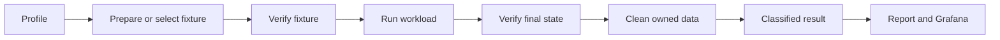

# Testing architecture

Make correctness visible, runs repeatable, and results comparable. Keep the
existing Go, Ruby, k6, Node, Prometheus and Grafana tools. Refactor one lifecycle
boundary at a time, preserving coverage and existing commands.

This document sets the direction. Shared DEV profiles, fixture manifests and a
common result contract are planned work. See the [load-test guide](../tests/load/README.md)
for implemented commands and the [capacity model](../tests/load/CAPACITY.md)
for measurement definitions.

## Test layers

| Layer | Purpose | Where it runs |
| --- | --- | --- |
| Go unit tests | Local logic and invariants | Every PR |
| Go integration/API tests | Real storage, workers and permissions | CI with explicit dependencies |
| Ruby system tests | Cross-instance business flows | CI with isolated test state |
| Harness tests and mock smoke | Verify the test tools themselves | Every harness PR |
| Shared DEV regression and capacity | Repeatable user workflows, bounded capacity searches | Controlled remote runs |
| Capacity and disruptive recovery | Find limits and recovery behavior | Dedicated, disposable infrastructure |

`make unit-tests` uses `-short`; it does not run all integration coverage.
Keep Go tests near their packages and reuse `tests/testutils`. Keep useful Ruby
coverage; replace brittle waits and shared state incrementally. Retire legacy
scalability scripts only when their coverage has an identified replacement.

## Load-test lifecycle

Persist partial outcomes on failure. A timeout does not establish that an
accepted write stopped; reconcile it before cleanup and retain uncertain state.

| Boundary | Responsibility |
| --- | --- |
| Profile | Target, dataset, actors, workload, budgets and criteria |
| Fixture tools | Provisioning, population, identities and ownership |
| k6 scenarios | Traffic, pacing, request metrics and immediate checks |
| Verification | Content, permissions, convergence and final state |
| Node orchestration | Lifecycle and decisions between complete runs |
| Reporting | Present producer verdicts and diagnostic evidence |

Keep `tests/load` as one npm package, with tests beside their modules and
separate Node/k6 TypeScript configurations. Keep Make targets thin. Group scripts
by provisioning, execution, verification and reporting when changing those
boundaries; a directory move alone is not a milestone. Share pure parsers and
contracts where useful, while keeping Node and k6 HTTP adapters separate.

Require Node >=22.23.4 for the harness. Use the same `node:22-alpine`
image for Linux checks, Compose and the DEV runner; refresh it and record the
resolved Node version and image digest. A cached tag alone does not establish
runtime compatibility. Keep HTTPS/IPv6 validation enabled.

Use k6 executors for steady traffic, ramps and arrival rates. Node coordinates
complete runs or observes a bounded administrative operation such as group
fan-out. State whether a rate counts workflows or individual requests. Upload
workers include readback, so their count is not simultaneous HTTP uploads.

## Fixtures and correctness

Create files and sharings through their dedicated Stack APIs. In managed DEV,
provision a test organization and its member instances through the managed
lifecycle and select them explicitly. The Stack-only seeder is for disposable
deployments.

A versioned fixture manifest records the generation seed, owned identities and
IDs, actor placement, directory shape, expected counts, sizes, checksums and
permissions. Keep credentials separate. Begin with a small deterministic
profile; measure preparation cost before increasing scale. Define index/cache
warm-up and distinguish it from the measured workload.

Verify the fixture before the run and reconcile it afterwards. Require zero
corruption and unauthorized access. Check each recipient's expected state;
aggregate event counts cannot prove delivery. Deduplicate notifications and
account for revisions coalesced by changes feeds. Record the scope of sampled
verification rather than presenting it as a complete check.

Snapshot capture and restore remain limited to isolated owned deployments.
Cleanup removes only resources recorded as owned by that fixture or run.

## Results

Use a versioned result contract with separate outcomes:

- Execution: complete, interrupted or infrastructure failure.
- Correctness: passed, failed or not verified.
- Performance: criteria met, violated or not measured.
- Capacity, when measured: exact under the search assumptions, lower bound,
  tested bracket or inconclusive.
- Cleanup: verified, retained intentionally or failed.

Record harness and deployed Stack versions separately, dataset/profile versions,
topology, resource limits, workload parameters, offered/achieved rate, latency,
errors, verification scope and timestamps. Keep private identities and secrets
out of published artifacts.

The producer owns the verdict. Reports and Grafana preserve it, including
unknown and inconclusive values. Normalize campaign and scenario entrypoints
to these exit codes, using the report as well as the child process status:

| Code | Meaning |
| --- | --- |
| 0 | Completed the declared mode with required verification and cleanup |
| 1 | Proven correctness failure, violation of an enabled regression criterion, or no passing capacity level |
| 2 | Inconclusive execution: setup, missing/invalid report, interruption, incomplete verification or failed cleanup |

A completed capacity search may return 0 with an exact result, lower bound or
tested bracket, including expected overload. A bracket is not a correctness
failure. Apply the same rule to uploads, activity ramps and fan-out; never
ignore an unexplained nonzero child exit. A proven failure takes precedence
over code 2, while the report retains every outcome, including cleanup failure.
The supervisor treats a killed process without a final report as inconclusive.

Before the DEV baseline is agreed, gate on functional correctness, completed
work and verified cleanup. Setup or cleanup failure returns 2. Record performance
without pass/fail thresholds; safety budgets and stop conditions still apply.

Retain raw diagnostics and a short human-readable report with dashboard links.
Compare only compatible workloads, datasets and environments, with repeated
runs and background activity recorded. Agree on absolute performance criteria
before using them as release gates.

## First deployment: shared DEV

Start with bounded smoke and regression tests. Inventory routing, deployed
versions, storage, queues and monitoring first; keep access details in the
private operational configuration.

Run k6 from a separate host against canonical URLs of explicitly selected test
instances. Keep provisioning credentials outside workload containers. The remote
profile must not invoke local Stack provisioning or change shared services.

For the first phase, execute all shared DEV campaigns on one designated load
VM. CI or laptops may submit work to that runner; they must not launch a separate
DEV campaign. Use one host-visible lock for the shared environment, also used
by runner containers, held through verification and cleanup. After interruption,
reconcile uncertain writes before allowing another run. A second runner requires
a shared lease or scheduler before it is enabled.

Apply campaign-specific concurrency, request, byte and time budgets. Abort on corruption,
unexpected access or agreed infrastructure limits. Verify monitoring and cleanup
before expanding the workload.

The DEV environment owner agrees stop conditions, monitoring and the run window.
The provisioning operator creates the test organization through the managed lifecycle
and supplies a scoped workload token with an expiry/rotation policy. The ingress
operator confirms the runner's source IP and required ingress/BunkerWeb access.
One person may hold several roles; record the named contacts privately before
execution. Inventory and access preparation run alongside the harness changes.

The first pilot is one 1 KiB upload with checksum readback and cleanup, followed
by two workers making five 1 MiB uploads each. Record normal DEV activity and
repeat the same workload to establish variability. Add owner/recipient workflows
after that baseline. Signup and membership-event testing stay separate workloads.

Shared DEV results establish regression behavior and capacity under recorded
conditions, within budgets and stop conditions agreed with the DEV owner.
Dependency disruption and deployment snapshot restores belong on isolated
infrastructure.

## Delivery order

Track the independently reviewable changes in
[#5052](https://github.com/linagora/cozy-stack/issues/5052) and its subissues.

1. Restore reliable harness checks and campaign outcomes. Inventory DEV in parallel.
2. Add bounded remote execution, then run and document the small DEV pilot.
3. Use that evidence to standardize result and fixture contracts.
4. Add distinct actors, recipient paths and per-reader correctness checks.
5. Extend representative data and mixed arrival-rate workloads, then bounded soaks.

The pilot requires the supported runtime, reliable outcomes, bounded remote
profile and confirmed operational access. CI wiring is a soft dependency: if it
is not merged, run and retain the equivalent container checks for the exact
pilot revision. The pilot does not wait for a broad rewrite.

Later organization and shared-drive work continues under
[#4866](https://github.com/linagora/cozy-stack/issues/4866)
and [#4867](https://github.com/linagora/cozy-stack/issues/4867), within the
[load-testing roadmap](https://github.com/linagora/cozy-stack/issues/4864).
